# 🛡️ Dark Web Threat Intelligence & Browser Activity Monitoring System

[](https://www.python.org/)
[](https://streamlit.io/)
[](https://www.sqlite.org/)
[](https://opensource.org/licenses/MIT)
[](https://github.com/psf/black)

A modern, real-time cybersecurity monitoring and threat intelligence platform built with **Python**, **Streamlit**, and **SQLite**. The system continuously monitors operating system and browser processes, detects unauthorized tools (dark web browsers, terminal consoles, administrative utilities), enforces configurable defensive policies (Log, Alert, Terminate), logs security telemetry, sends instant email notifications, and visualizes comprehensive threat metrics in an interactive SOC dashboard.

---

## 📌 Key Features

- **🔍 Real-Time Process Surveillance:** Continuously polls and tracks process lifecycles via `psutil` to detect newly spawned processes.
- **🔐 Secure Authentication & RBAC:** User registration and login protected with salted **Bcrypt** password hashing, featuring Role-Based Access Control (`Admin` and `User`).
- **🛡️ Database-Driven Threat Rules Engine:** All detection criteria and severity classifications (`Low`, `Medium`, `High`, `Critical`) are stored dynamically in SQLite, allowing rule modifications without code redeployments.
- **⚙️ Dynamic Security Policies & Auto-Block:** Configure rule-specific responses (Log, Email Alert, or Immediate Process Termination) directly from the UI.
- **📊 Security Operations Center (SOC) Dashboard:** Real-time visual monitoring with autorefresh, KPI metric cards, threat severity banners, and live activity feeds.
- **📈 Advanced Analytics:** Donut status breakdowns, process frequency rankings, category distributions, threat scoring gauges, and interactive time-series trends using Plotly.
- **📋 Searchable Security Audit Logs:** Search, filter, and export threat event logs directly to CSV for compliance and forensics.
- **📧 Automated SMTP Alerts:** Real-time email dispatch notifying security administrators upon high-risk or blocked threat detections.
- **👨‍💼 Centralized Admin Panel:** Search, promote, demote, and manage user accounts with safeguard constraints against self-demotion or orphan administrator accounts.
- **🧪 Built-in Test Suite:** Full automated test coverage (`test_system.py`) verifying database integrity, authentication, threat rules, sessions, metrics, and visualization components.

---

## 🏗️ System Architecture

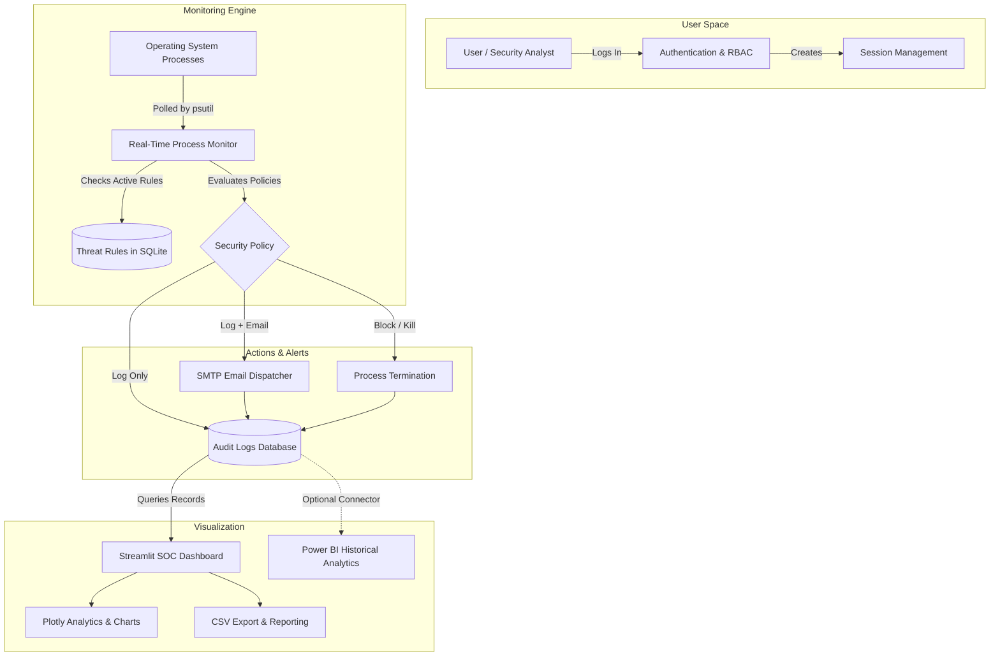

---

## 🛠️ Technology Stack

| Component | Technology | Description |
| :--- | :--- | :--- |
| **Language** | Python 3.11 / 3.12 | Core backend and business logic |
| **Frontend / Web UI** | Streamlit | Real-time interactive SOC dashboard |
| **Database** | SQLite 3 | Relational store for users, threat rules, and event logs |
| **System Inspection** | Psutil | Cross-platform process and system monitoring |
| **Cryptography** | Bcrypt | Password hashing and salt verification |
| **Visualizations** | Plotly & Plotly Express | Interactive charts (Donut, Bar, Scatter, Gauge) |
| **Data Processing** | Pandas | Log manipulation, filtering, and aggregation |
| **Notifications** | SMTP (`smtplib` + `email`) | Automated threat email dispatches |
| **Analytics BI** | Microsoft Power BI | Historical threat modeling & long-term reporting |

---

## 📂 Project Structure

```text
Dark-Web-Threat-Monitoring-System/
├── dashboard.py           # Main Streamlit web application & SOC view
├── monitor.py             # Background process monitoring engine
├── detector.py            # Process baseline initialization & delta detection
├── database.py            # SQLite schema initialization & database queries
├── login.py               # Login & user registration interface
├── user_auth.py           # Bcrypt password verification & user management
├── session.py             # Active user session handler
├── settings.py            # Configuration loader and defaults
├── settings.json          # Persisted security policy and monitor switches
├── threat_rules.py        # Threat rule management interface
├── admin.py               # Administrator panel for user roles
├── charts.py              # Plotly chart definitions
├── ui.py                  # HTML/CSS themes, badges, and metric cards
├── utils.py               # Log querying, threat score calculation & filters
├── logger.py              # Event logging dispatcher
├── notifications.py       # Notification center view
├── email_service.py       # SMTP notification integration
├── system_status.py       # Health check probes for system components
├── create_tables.py       # Database schema initialization script
├── make_admin.py          # CLI utility to promote users to Admin
├── test_system.py         # Automated unit and integration test suite
├── requirements.txt       # Python package dependencies
├── run_dashboard.bat      # Windows one-click dashboard launcher
├── run_monitor.bat        # Windows one-click monitor launcher
├── .env.example           # SMTP credential configuration template
├── LICENSE                # MIT License
├── README.md              # Project documentation
└── assets/
    └── screenshots/       # Application screenshots & UI previews
```

---

## 🚀 Getting Started

### 1. Prerequisites
- **Python 3.11 or 3.12** installed on your system.
- **Git** installed.

### 2. Clone the Repository
```bash
git clone https://github.com/tanishqzope/Dark-Web-Threat-Monitoring-System.git
cd Dark-Web-Threat-Monitoring-System
```

### 3. Set Up Virtual Environment & Dependencies
```bash
# Create virtual environment
python -m venv .venv

# Activate virtual environment
# Windows (PowerShell):
.\.venv\Scripts\Activate.ps1
# Windows (Command Prompt):
.\.venv\Scripts\activate.bat
# Linux / macOS:
source .venv/bin/activate

# Install required packages
pip install -r requirements.txt
```

### 4. Initialize Database
```bash
python create_tables.py
```

---

## 💻 Running the Application

### Option A: One-Click Launchers (Windows)
Double-click the provided batch scripts in the project directory:
1. **`run_dashboard.bat`** — Launches the Streamlit SOC dashboard.
2. **`run_monitor.bat`** — Launches the real-time background monitor console.

---

### Option B: Command Line Interface (CLI)

#### Terminal 1 — Start the Dashboard:
```bash
streamlit run dashboard.py
```
Open **[http://localhost:8501](http://localhost:8501)** in your web browser.

#### Terminal 2 — Start the Monitor:
```bash
python monitor.py
```

---

## 🔑 Default Credentials

A default Administrator account is pre-configured for instant access:

| Role | Username | Password |
| :--- | :--- | :--- |
| **Administrator** | `admin` | `admin123` |

> 💡 *You can also create your own account using the **📝 Register** tab on the login screen.*

---

## 🧪 Automated Testing

Run the included automated test suite to verify database schemas, authentication, threat rules, sessions, metrics, and visualization components:

```bash
python test_system.py
```

Expected output:
```text
============================================================
RUNNING AUTOMATED TEST SUITE FOR THREAT MONITORING SYSTEM
============================================================
test_01_database_initialization ... ok
test_02_user_auth ... ok
test_03_threat_rules ... ok
test_04_session_management ... ok
test_05_settings ... ok
test_06_logs_and_scoring ... ok
test_07_system_status ... ok
test_08_process_detector ... ok
test_09_plotly_charts ... ok

----------------------------------------------------------------------
Ran 9 tests in 4.4s

OK
```

---

## 📸 Screenshots & Previews

### 🔐 Authentication Module
| Login Interface | User Registration |
| :---: | :---: |
| 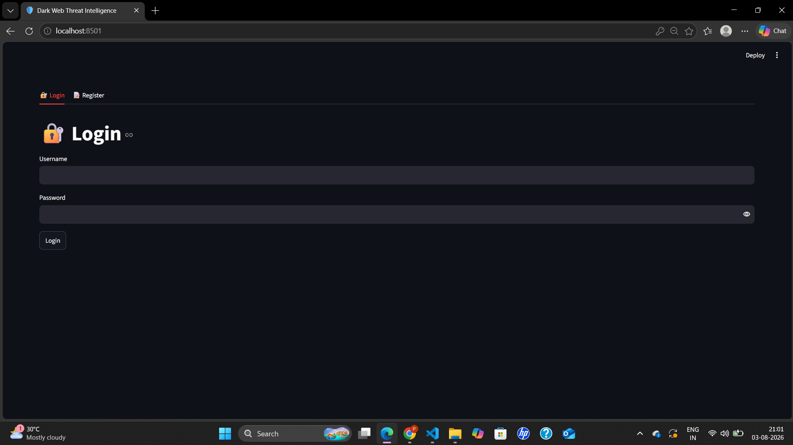 | 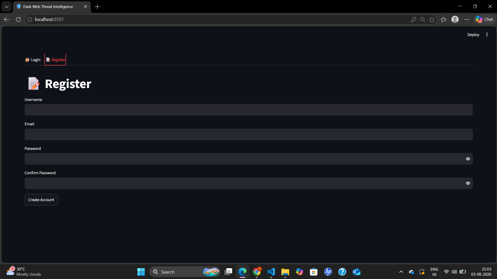 |

---

### 🏠 Security Operations Center (SOC)
| Dashboard Overview | System Metrics & Threat Level |
| :---: | :---: |
| 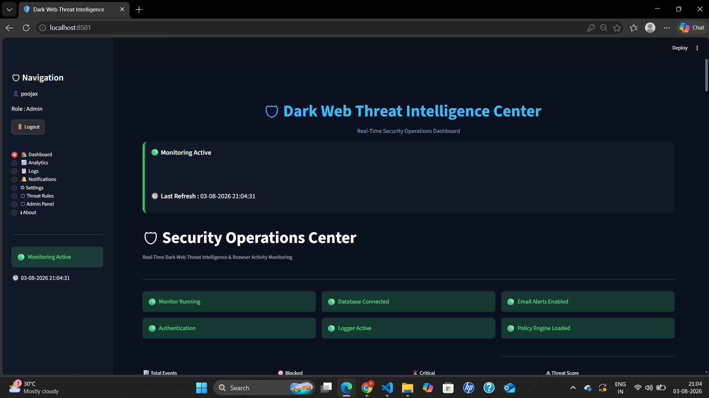 | 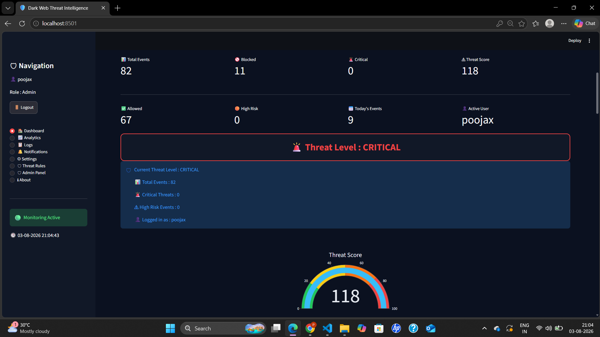 |

| Live Activity Feed | Security Event Logs |
| :---: | :---: |
| 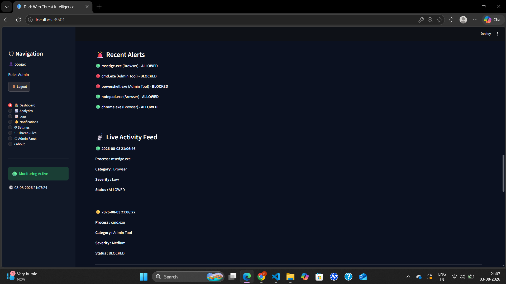 | 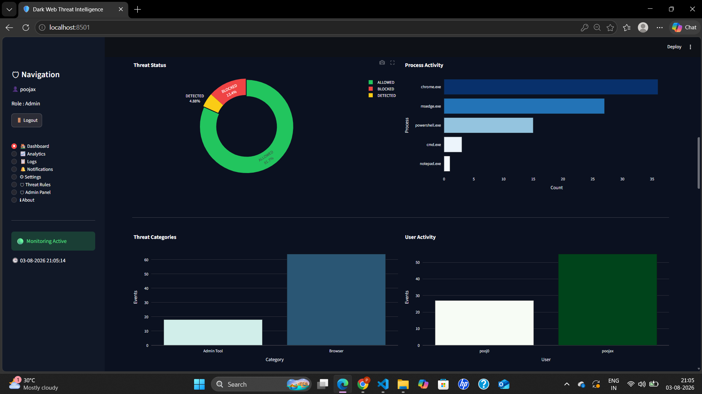 |

---

### 📈 Threat Analytics
| Category & User Distributions | Time Series Threat Activity |
| :---: | :---: |
| 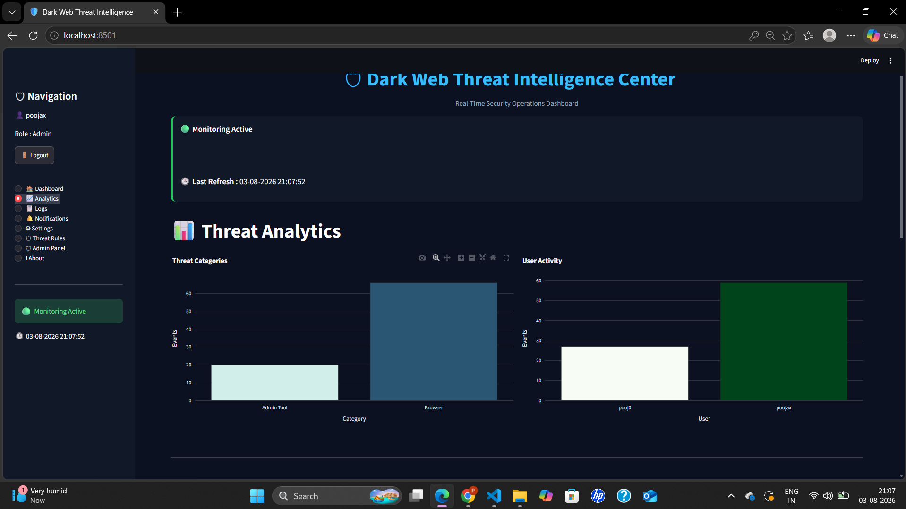 |  |

---

### 🛡️ Threat Rules & Security Policies
| Threat Rules Engine | Policy & Monitoring Settings |
| :---: | :---: |
| 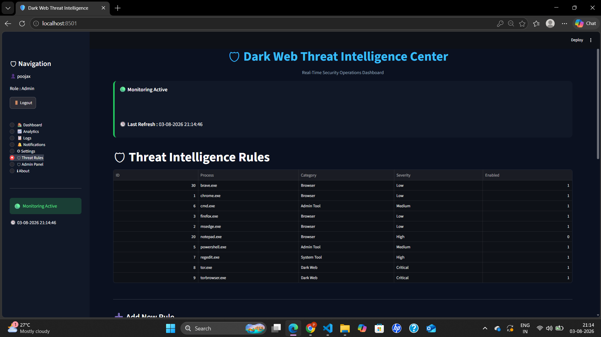 | 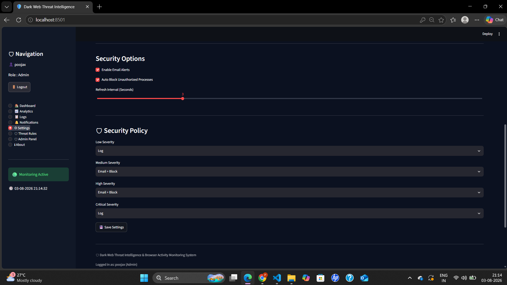 |

---

### 👨‍💼 Admin Panel & Power BI
| User Management Panel | Historical Power BI Reporting |
| :---: | :---: |
| 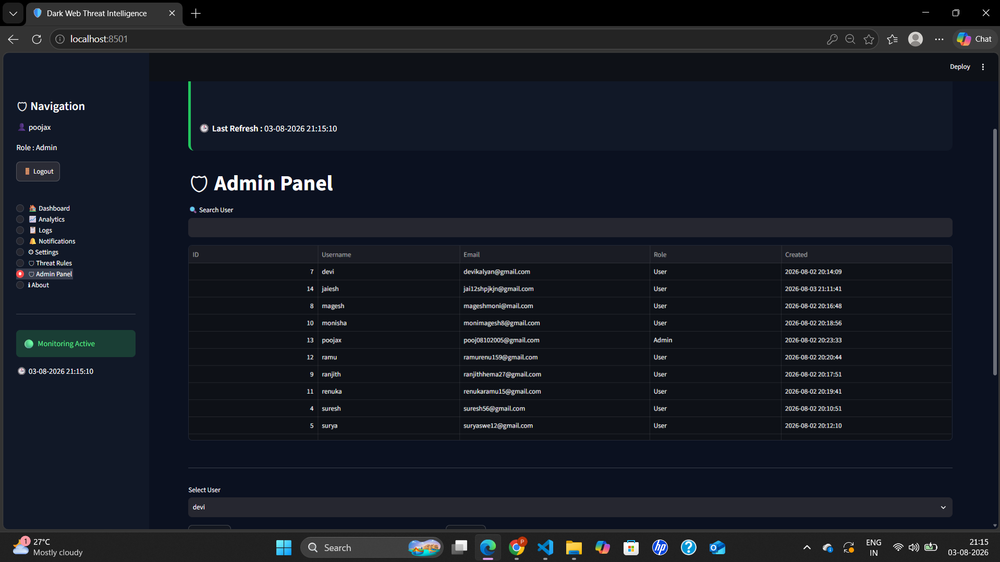 | 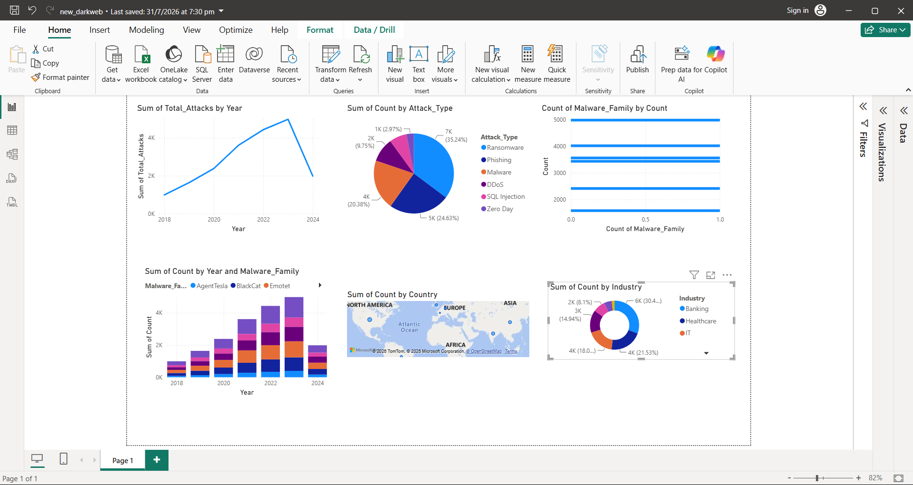 |

---

## 📧 Email Alerts Configuration (Optional)

To enable real-time alert emails on detection:
1. Copy [`.env.example`](.env.example) to `.env`:
   ```bash
   cp .env.example .env
   ```
2. Fill in your Gmail SMTP credentials:
   ```env
   SENDER_EMAIL=your_email@gmail.com
   RECEIVER_EMAIL=analyst_alerts@gmail.com
   APP_PASSWORD=your_16_character_app_password
   ```
3. Enable **Email Alerts** in the **⚙ Settings** tab on the dashboard.

---

## 📄 License

This project is licensed under the MIT License — see the [LICENSE](LICENSE) file for details.

---

## 👤 Author

**Tanishq Atul Zope**
- **GitHub:** [@tanishqzope](https://github.com/tanishqzope)
- **Repository:** [Dark-Web-Threat-Monitoring-System](https://github.com/tanishqzope/Dark-Web-Threat-Monitoring-System.git)
