# 🛡️ Dark Web Threat Intelligence & Browser Activity Monitoring System

[](https://github.com/tanishqzope/Dark-Web-Threat-Monitoring-System/actions/workflows/tests.yml)
[](https://www.python.org/)
[](https://streamlit.io/)
[](https://www.sqlite.org/)
[](https://plotly.com/)
[](https://opensource.org/licenses/MIT)
[](https://github.com/psf/black)

A real-time cybersecurity monitoring, process surveillance, and threat intelligence platform developed with **Python**, **Streamlit**, and **SQLite**. The system actively detects unauthorized dark web browsers, malicious executables, administrative consoles, and registry manipulation tools. It enforces dynamic automated policies (**Log Only**, **Email Alert**, or **Automatic Process Termination**), records granular event logs in a relational database, sends instant SMTP email alerts, and visualizes comprehensive threat telemetry in an interactive SOC dashboard.

---

## 📌 Key Capabilities

- **🔍 Real-Time Process Surveillance:** Continuously scans operating system process lifecycles with `psutil` to catch newly spawned processes.
- **🔐 Secure Authentication & RBAC:** User accounts protected with salted **Bcrypt** cryptographic password hashing, supporting **Admin** and **User** role tiers.
- **🛡️ Database-Driven Threat Rules Engine:** All detection criteria and severity classifications (`Low`, `Medium`, `High`, `Critical`) are stored dynamically in SQLite — configure and update rules on the fly without restarting code.
- **⚙️ Dynamic Security Policies & Auto-Block:** Configure rule-specific responses (Log, Email Alert, or Immediate Process Termination) directly from the dashboard.
- **📊 Security Operations Center (SOC) Dashboard:** Real-time visual monitoring with auto-refresh intervals, live KPI metric cards, threat severity alerts, and continuous activity feeds.
- **📈 Advanced Threat Analytics:** Plotly-powered Donut status charts, process frequency rankings, category distributions, threat scoring gauges (0–100), and interactive time-series timeline graphs.
- **📋 Searchable Security Audit Logs:** Search, filter, and export threat event logs directly to CSV for compliance, reporting, and forensic review.
- **📧 Automated SMTP Alerts:** Instant email notifications dispatched to security personnel upon high-risk or blocked threat detections.
- **👨‍💼 Centralized Admin Panel:** Search, promote, demote, and manage user accounts with safeguard constraints against self-demotion or orphan administrator accounts.
- **🧪 Built-in Test Suite:** Full automated test coverage (`test_system.py`) verifying database integrity, authentication, threat rules, sessions, metrics, and visualization components.

---

## 🏗️ System Architecture

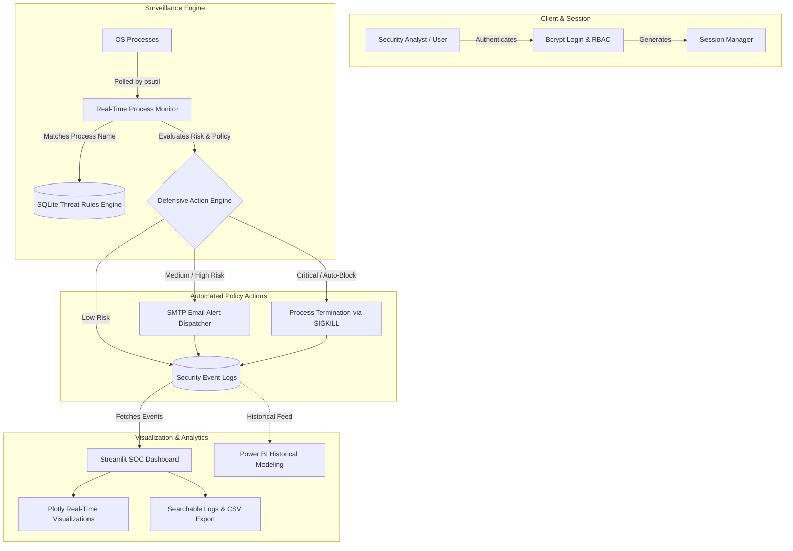

---

## 📸 Complete Visual Tour

### 🔐 1. Authentication & Access Control
| User Login Interface | User Account Registration |
| :---: | :---: |
| 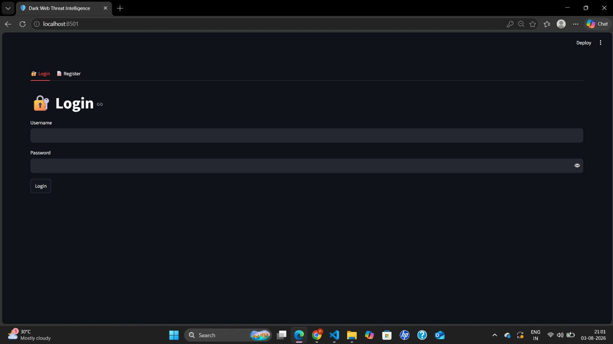 | 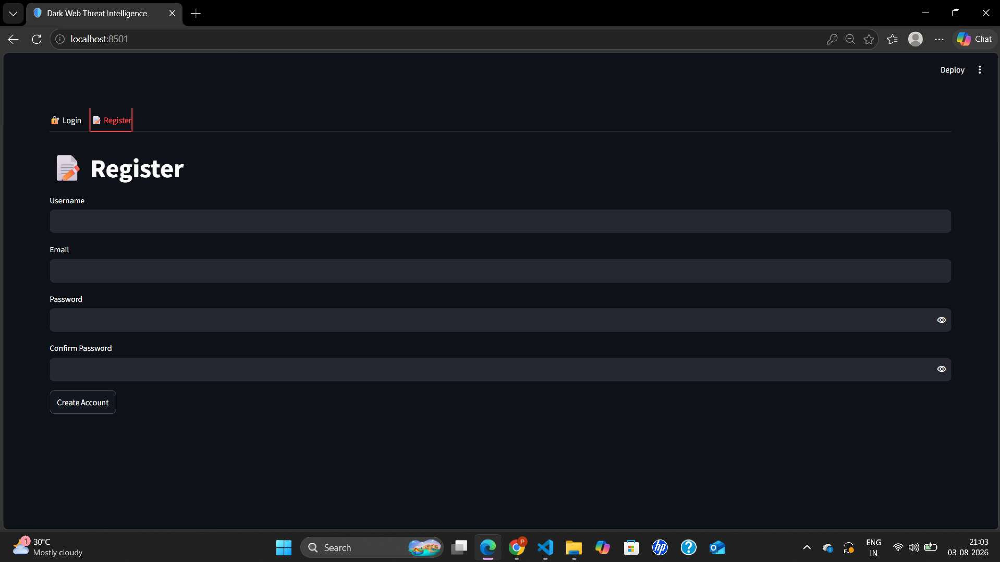 |
| *Bcrypt-secured login verifying user identity and roles.* | *Self-service account registration with email validation.* |

---

### 🏠 2. Security Operations Center (SOC) Dashboard
| System Health & Component Status | Threat Metrics & Severity Gauge |
| :---: | :---: |
| 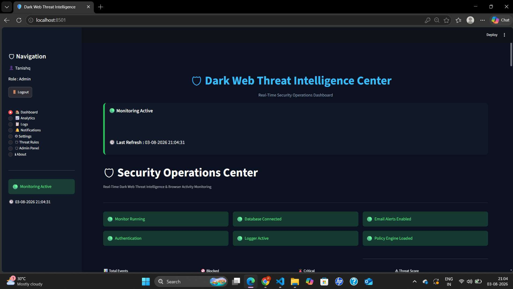 | 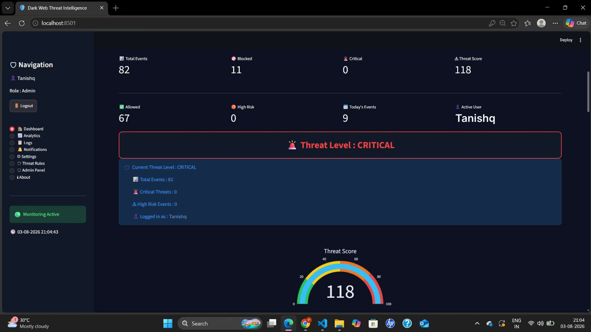 |
| *Live health indicators for Monitor, Database, Logger, Auth & Policies.* | *Dynamic Threat Score (0–100) and critical event count metrics.* |

| Threat Status & Distribution Charts | Live Activity Feed & Recent Alerts |
| :---: | :---: |
|  | 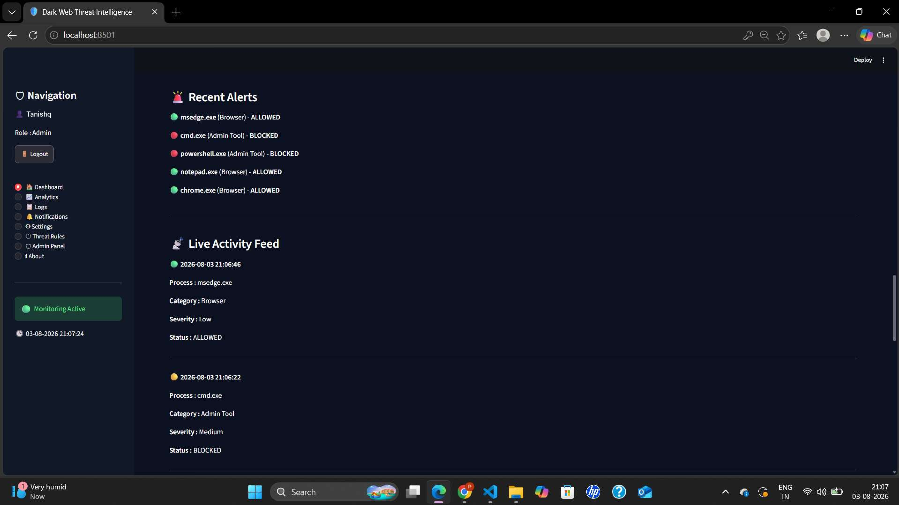 |
| *Plotly Donut chart for Allowed / Detected / Blocked events.* | *Real-time event alerts stream updating every 2–3 seconds.* |

---

### 📈 3. Deep Threat Analytics
| Category & User Risk Distribution | Process Frequency & Timeline Trends |
| :---: | :---: |
| 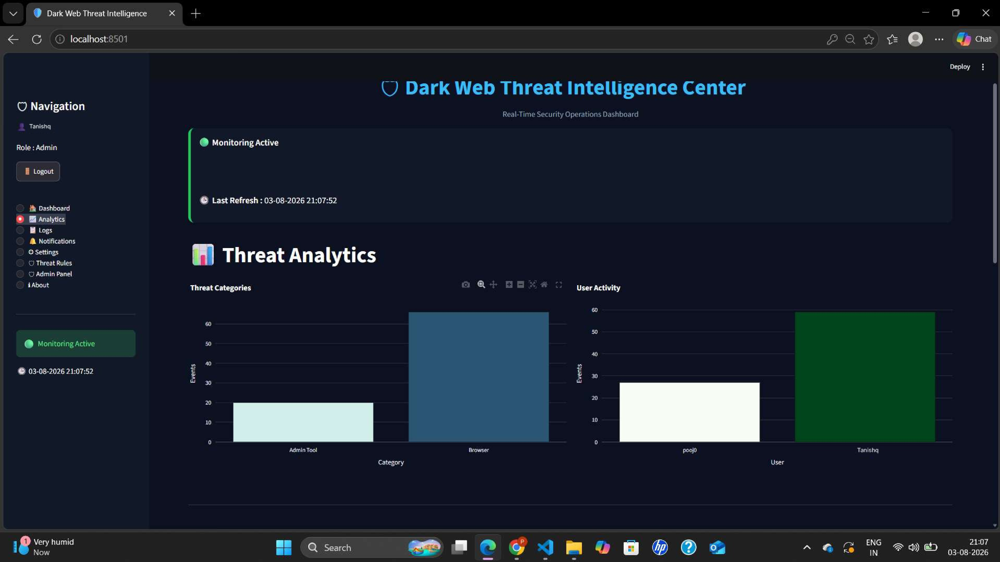 | 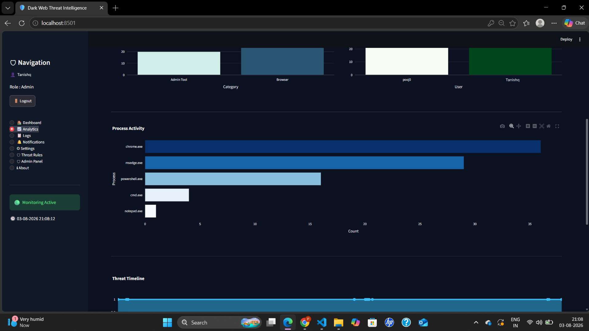 |
| *Incident breakdown by tool category (Browser, Admin Tool, Dark Web).* | *Horizontal process bar chart & cumulative timeline graph.* |

---

### 📋 4. Security Audit Logs & Notification Center
| Searchable Event Logs Table (with CSV Export) | Centralized Notification Center |
| :---: | :---: |
| 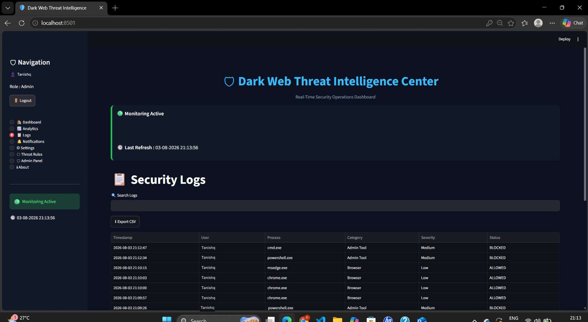 | 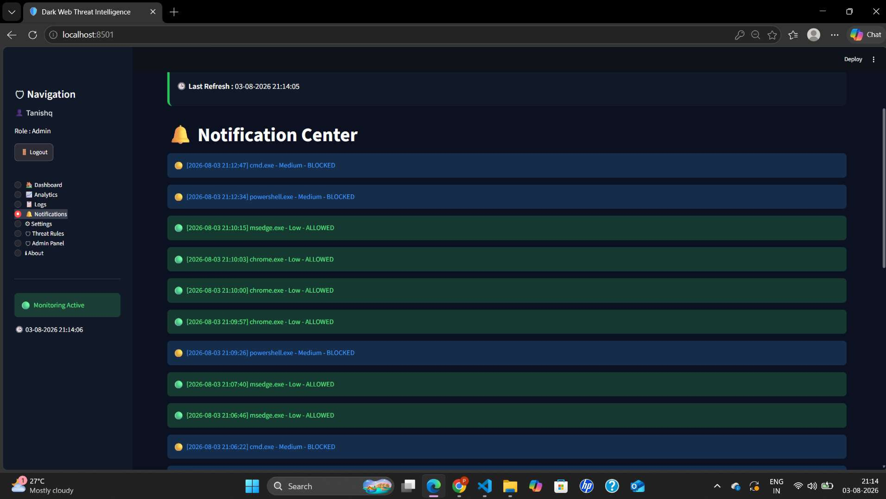 |
| *Full audit trail with timestamp, process, severity, and CSV export.* | *Color-coded notification alerts sorted by incident criticality.* |

---

### 🛡️ 5. Threat Rules Engine & Policy Customization
| Process Monitoring Toggles | Security Policy Actions (Log / Alert / Block) |
| :---: | :---: |
| 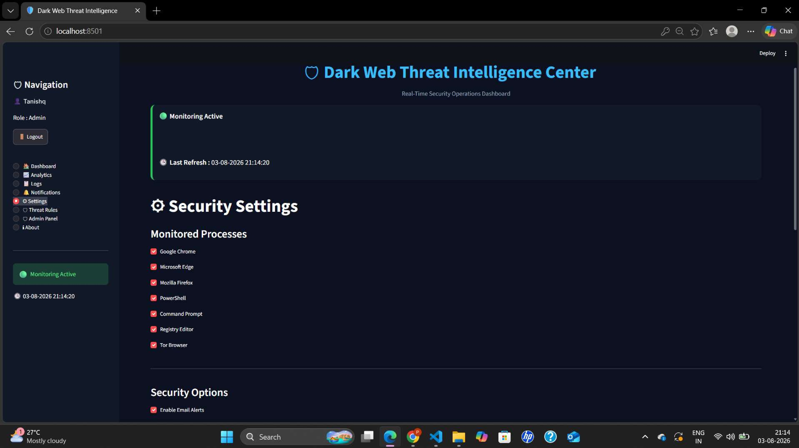 | 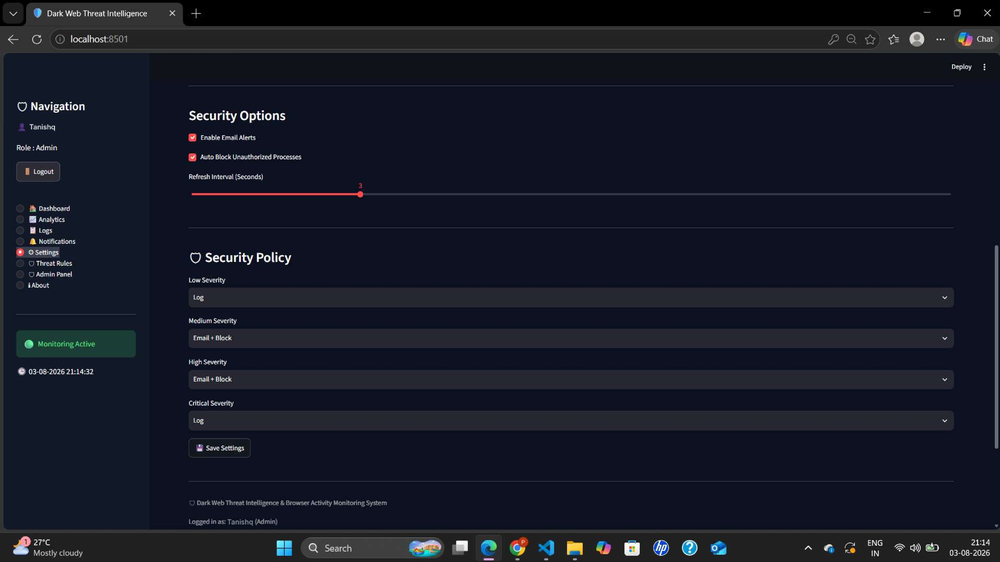 |
| *Selective process switches for Chrome, Edge, PowerShell, Tor, etc.* | *Granular response rules mapped per severity tier.* |

| Threat Rules Database Inventory | Add & Edit Custom Rules Form |
| :---: | :---: |
| 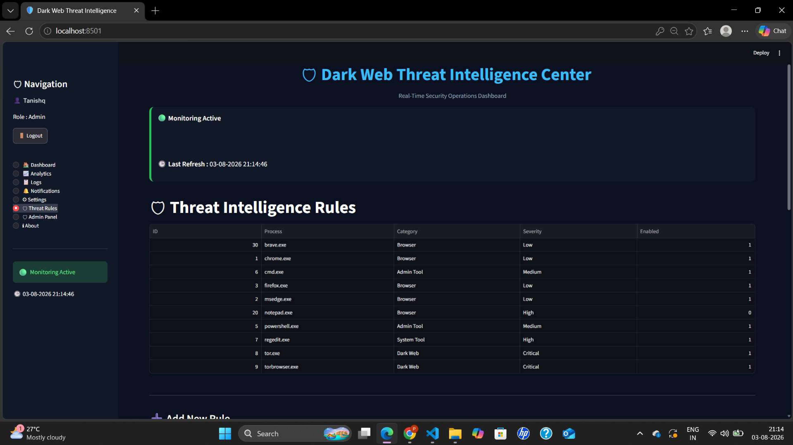 | 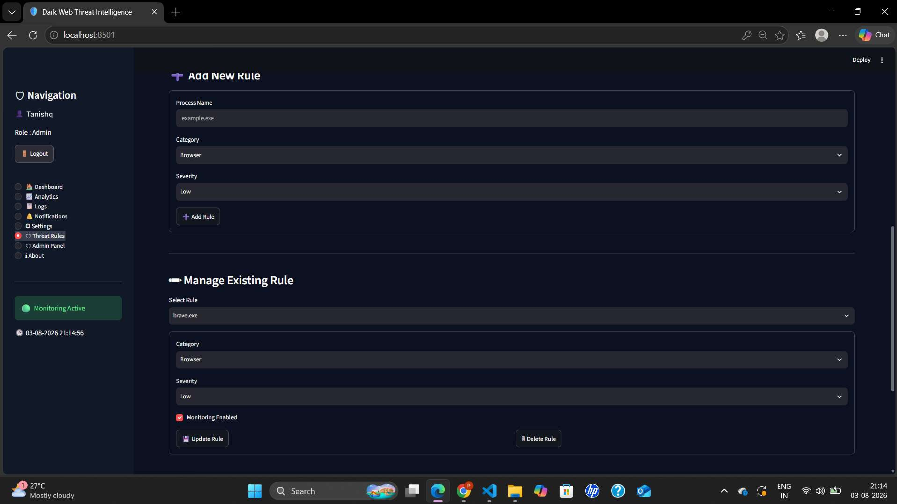 |
| *Live database rules list with enabled/disabled status.* | *Dynamic forms to register new suspicious executables.* |

---

### 👨‍💼 6. Administration, Power BI & Email Alerts
| User Management Admin Panel | Automated Gmail Alert Dispatch |
| :---: | :---: |
| 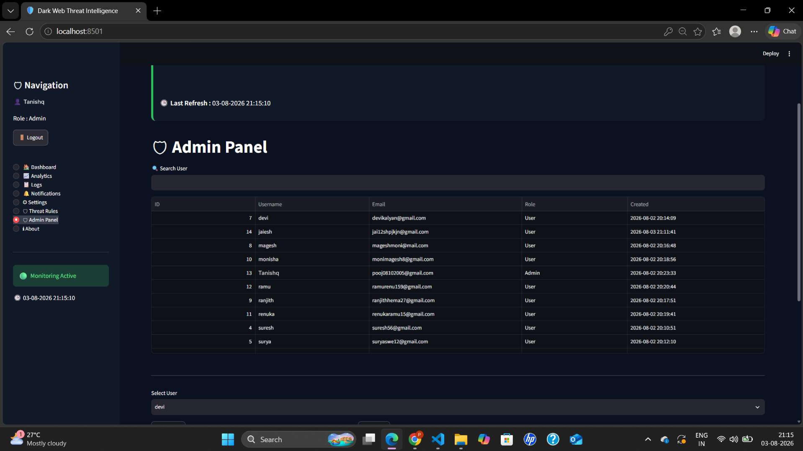 | 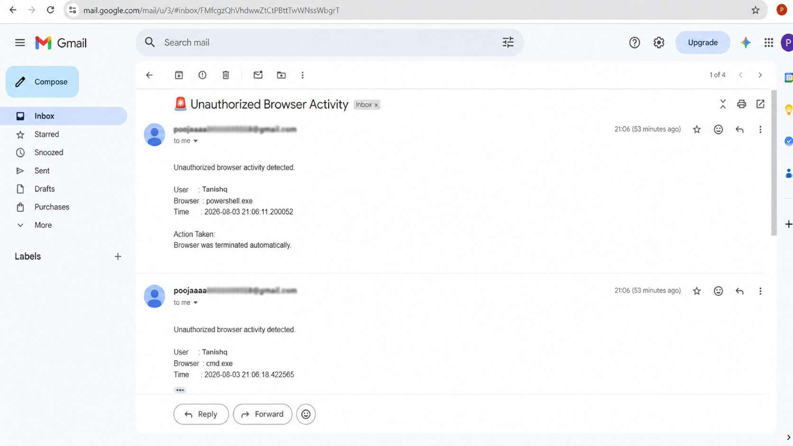 |
| *Role promotion, demotion, and account management tools.* | *Real-time alert email triggered upon blocked process execution.* |

| Historical Power BI Analytics | Platform Overview & Tech Specifications |
| :---: | :---: |
| 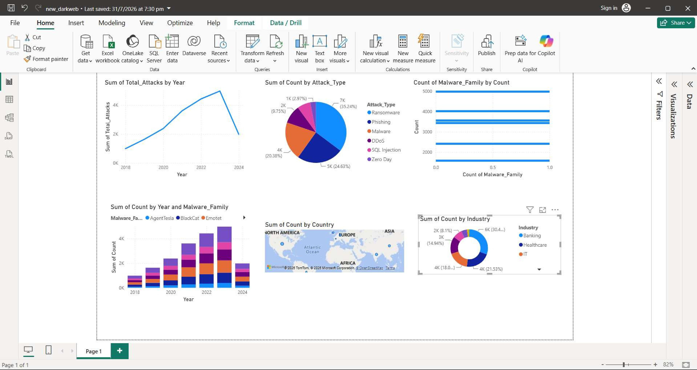 | 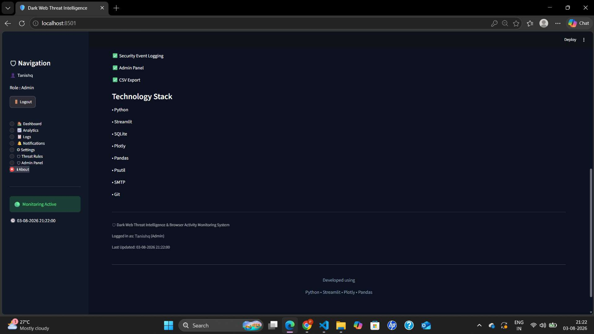 |
| *Multi-year attack trend modeling, malware families, and geo-analysis.* | *System information, architecture footprint, and technology stack.* |

---

## 🛠️ Technology Stack

| Category | Technology | Purpose |
| :--- | :--- | :--- |
| **Language** | Python 3.11 / 3.12 | Core backend, process monitoring, and data pipelines |
| **Frontend / Web UI** | Streamlit | Real-time interactive SOC dashboard |
| **Database** | SQLite 3 | Relational database for logs, users, and threat rules |
| **Process Inspection** | Psutil | Operating system process lifecycle monitoring |
| **Cryptography** | Bcrypt | Password hashing and salt verification |
| **Visualizations** | Plotly & Plotly Express | Interactive charts (Donut, Bar, Scatter, Gauge) |
| **Data Processing** | Pandas | Log manipulation, filtering, and aggregation |
| **Notifications** | SMTP (`smtplib` + `email`) | Automated threat email dispatches |
| **Analytics BI** | Microsoft Power BI | Historical threat modeling & long-term reporting |

---

## 📂 Project Structure

```text
Dark-Web-Threat-Monitoring-System/
├── .github/
│   └── workflows/
│       └── tests.yml          # GitHub Actions automated CI workflow
├── dashboard.py               # Main Streamlit web application & SOC view
├── monitor.py                 # Background process monitoring engine
├── detector.py                # Process baseline initialization & delta detection
├── database.py                # SQLite schema initialization & database queries
├── login.py                   # Login & user registration interface
├── user_auth.py               # Bcrypt password verification & user management
├── session.py                 # Active user session handler
├── settings.py                # Configuration loader and defaults
├── settings.json              # Persisted security policy and monitor switches
├── threat_rules.py            # Threat rule management interface
├── admin.py                   # Administrator panel for user roles
├── charts.py                  # Plotly chart definitions
├── ui.py                      # HTML/CSS themes, badges, and metric cards
├── utils.py                   # Log querying, threat score calculation & filters
├── logger.py                  # Event logging dispatcher
├── notifications.py           # Notification center view
├── email_service.py           # SMTP notification integration
├── system_status.py           # Health check probes for system components
├── create_tables.py           # Database schema initialization script
├── make_admin.py              # CLI utility to promote users to Admin
├── test_system.py             # Automated unit and integration test suite
├── requirements.txt           # Python package dependencies
├── run_dashboard.bat          # Windows one-click dashboard launcher
├── run_monitor.bat            # Windows one-click monitor launcher
├── .env.example               # SMTP credential configuration template
├── LICENSE                    # MIT License
├── README.md                  # Project documentation
└── assets/
    └── screenshots/           # Screenshots & UI documentation
        ├── auth-login.jpg
        ├── auth-register.jpg
        ├── dashboard-soc-status.jpg
        ├── dashboard-metrics-gauge.jpg
        ├── dashboard-charts.jpg
        ├── dashboard-alerts-feed.jpg
        ├── analytics-categories-users.jpg
        ├── analytics-process-timeline.jpg
        ├── security-logs.jpg
        ├── notification-center.jpg
        ├── settings-monitoring.jpg
        ├── settings-policy.jpg
        ├── threat-rules.jpg
        ├── threat-rule-actions.jpg
        ├── admin-panel.jpg
        ├── email-alert.jpg
        ├── powerbi-dashboard.jpg
        ├── about-features.jpg
        └── about-tech-stack.jpg
```

---

## 🚀 Getting Started

### 1. Prerequisites
- **Python 3.11 or 3.12** installed on your system.
- **Git** installed.

### 2. Clone the Repository
```bash
git clone https://github.com/tanishqzope/Dark-Web-Threat-Monitoring-System.git
cd Dark-Web-Threat-Monitoring-System
```

### 3. Set Up Virtual Environment & Dependencies
```bash
# Create virtual environment
python -m venv .venv

# Activate virtual environment
# Windows (PowerShell):
.\.venv\Scripts\Activate.ps1
# Windows (Command Prompt):
.\.venv\Scripts\activate.bat
# Linux / macOS:
source .venv/bin/activate

# Install required packages
pip install -r requirements.txt
```

### 4. Initialize Database
```bash
python create_tables.py
```

---

## 💻 Running the Application

### Option A: One-Click Launchers (Windows)
Double-click the provided batch scripts in the project directory:
1. **`run_dashboard.bat`** — Launches the Streamlit SOC dashboard.
2. **`run_monitor.bat`** — Launches the real-time background monitor console.

---

### Option B: Command Line Interface (CLI)

#### Terminal 1 — Start the Dashboard:
```bash
streamlit run dashboard.py
```
Open **[http://localhost:8501](http://localhost:8501)** in your web browser.

#### Terminal 2 — Start the Monitor:
```bash
python monitor.py
```

---

## 🔑 Default Credentials

A default Administrator account is pre-configured for instant access:

| Role | Username | Password |
| :--- | :--- | :--- |
| **Administrator** | `admin` | `admin123` |

> 💡 *You can also create your own account using the **📝 Register** tab on the login screen.*

---

## 🧪 Automated Testing

Run the included automated test suite to verify database schemas, authentication, threat rules, sessions, metrics, and visualization components:

```bash
python test_system.py
```

Expected output:
```text
============================================================
RUNNING AUTOMATED TEST SUITE FOR THREAT MONITORING SYSTEM
============================================================
test_01_database_initialization ... ok
test_02_user_auth ... ok
test_03_threat_rules ... ok
test_04_session_management ... ok
test_05_settings ... ok
test_06_logs_and_scoring ... ok
test_07_system_status ... ok
test_08_process_detector ... ok
test_09_plotly_charts ... ok

----------------------------------------------------------------------
Ran 9 tests in 4.4s

OK
```

---

## 📧 Email Alerts Configuration (Optional)

To enable real-time alert emails on detection:
1. Copy [`.env.example`](.env.example) to `.env`:
   ```bash
   cp .env.example .env
   ```
2. Fill in your Gmail SMTP credentials:
   ```env
   SENDER_EMAIL=your_email@gmail.com
   RECEIVER_EMAIL=analyst_alerts@gmail.com
   APP_PASSWORD=your_16_character_app_password
   ```
3. Enable **Email Alerts** in the **⚙ Settings** tab on the dashboard.

---

## 📄 License

This project is licensed under the MIT License — see the [LICENSE](LICENSE) file for details.

---

## 👤 Author

**Tanishq Atul Zope**
- **GitHub:** [@tanishqzope](https://github.com/tanishqzope)
- **Repository:** [Dark-Web-Threat-Monitoring-System](https://github.com/tanishqzope/Dark-Web-Threat-Monitoring-System.git)
